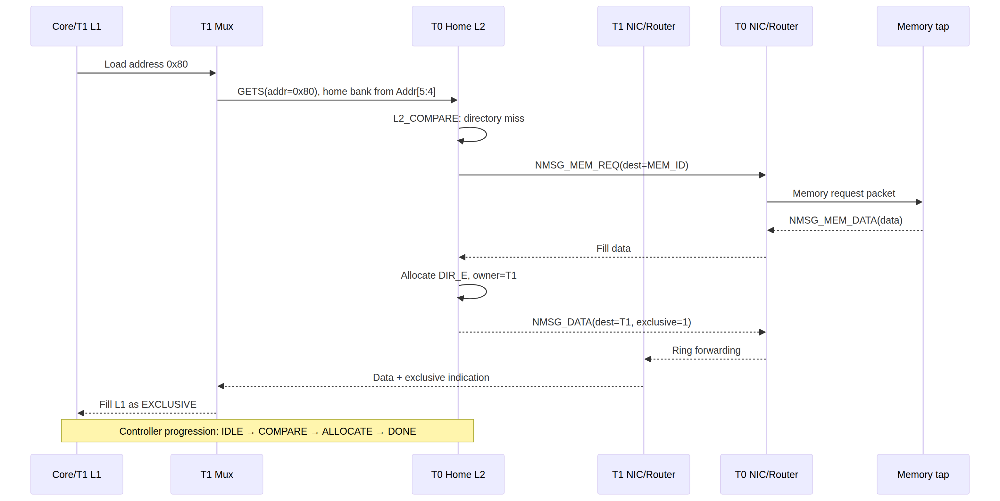

# Multi-Core Cache Project Cheat Sheet

This guide starts from zero knowledge and ends with the exact flow needed to read, simulate, debug, and extend the project.

## 1. One-sentence model

There are two tiles. Each tile has a private L1 cache and a local L2 bank, but all L2 banks together form one logically shared directory-backed cache. Tiles communicate over a bidirectional ring using NIC packets and routers.

```text
Core → private L1 → tile mux → home L2 directory → memory or owner/sharers
                                      ↓
                              NIC packet → router ring → remote tile
```

## 2. What each level owns

| Level | Private/shared | Main job | Lookup fields |
|---|---|---|---|
| Core input | Per tile | Produces 10-bit load/store instruction and write data | Operation + address |
| L1 | Private | Fast data and MESI state for that tile | Tag `[7:4]`, set `[3:2]` |
| L2 bank | Physically local, logically shared | Data plus directory/ownership/order point | Home bank `[5:4]`, set `[7:6]`, tag `[3:0]` |
| NIC | Per tile | Packet FIFO and flit conversion | Destination/source/message fields |
| Router | Per tile | Local/CW/CCW ring forwarding | Flit destination `[31:30]` |
| Memory tap | Endpoint | Preload and returns data packets | `NMSG_MEM_REQ/DATA` |

## 3. Repository map

Start here when opening the project:

1. `tile.sv` — integration and signal flow.
2. `Tile_2tb.sv` — the executable two-tile scenario.
3. `cache_controller.sv` — L1 behavior.
4. `L2_cache_controller.sv` — directory and coherence behavior.
5. `cache_interface.sv` and `L2_cache_interface.sv` — module contracts.
6. `L1_cache_mem.sv` and `l2_cache_pkg.sv` — types, states, and messages.
7. `Mux.sv` — local traffic selection.
8. `NIC.sv` and `Router.sv` — packet transport.
9. `mem.sv` — memory endpoint.
10. `cache_storage.sv`, `L2_cache_storage.sv`, `cache_lru.sv` — arrays and replacement.

## 4. Address decoding from scratch

### L1

For an 8-bit address `A`:

```text
A[7:4] = L1 tag
A[3:2] = L1 set, values 0..3
A[1:0] = unused line offset in this one-byte/word prototype
```

Example: `0x01` is binary `0000_0001`, so tag `0`, set `0`.

### L2

```text
A[7:6] = L2 set, values 0..3
A[5:4] = home bank/tile
A[3:0] = L2 tag
```

Example: `0x40` has set `1`, home bank `0`, tag `0`. `0x80` has set `2`, home bank `0`, tag `0`. Therefore T1’s `0x80` request must travel to T0’s home directory and return over the ring.

## 5. Cache-line state quick reference

### L1 states

| State | Read hit | Write hit | Other meaning |
|---|---:|---:|---|
| `INVALID` | No | No | Must fill or obtain permission |
| `EXCLUSIVE` | Yes | Silent E→M | Only clean copy |
| `SHARED` | Yes | Send GETM/invalidate | Other copies may exist |
| `MODIFIED` | Yes | Yes | Only dirty copy |

Transient names ending in `_D` or `_A` mean that a request, response, allocation, or eviction is still outstanding. Do not treat them as stable data states.

### L2 states

| State | Directory meaning |
|---|---|
| `DIR_I` | No valid entry |
| `DIR_E` | One clean owner; `owner_id` identifies it |
| `DIR_S` | Shared; `sharers` mask identifies holders |
| `DIR_M` | One dirty owner; `owner_id` identifies it |
| `DIR_MEM_WAIT` | Waiting for memory data |
| `DIR_FWD_WAIT` | Waiting for owner-forwarded data |
| `DIR_INV_WAIT` | Waiting for invalidation acknowledgements |

Invariant to remember:

```text
DIR_E/DIR_M → exactly one owner bit in sharers
DIR_S        → sharers is nonzero
DIR_I        → valid is false and sharers is zero
```

The bounded formal policy proof checks these invariants for 20 steps.

## 6. Message quick reference

### Core/L1 toward L2

- `MSG_GETS`: request a clean read copy.
- `MSG_GETM`: request write permission.
- `MSG_PUTE`: return/evict a clean exclusive line.
- `MSG_PUTM`: write back a modified line.
- `MSG_INVACK`: acknowledge invalidation.
- `MSG_DATAFWD`: forward data from an owner.

### L2 toward L1

- `MSG_FWD_GETS`: ask an owner to provide data for a shared read.
- `MSG_FWD_GETM`: ask an owner to provide data for a writer.
- `MSG_INV`: invalidate a copy.
- `MSG_DATA`: provide a fill.

### NIC packets

The packet adds a network message, write-enable, exclusive flag, address, data, source ID, and destination ID. The NIC packs these fields into a 32-bit flit; the router only needs the destination field.

## 7. Controller state flow

### L1 flow

```text
IDLE
  ↓ core instruction
COMPARE
  ├─ hit and locally complete → DONE → IDLE
  ├─ miss → ALLOCATE
  ├─ dirty victim → WRITEBACK
  └─ snoop arrives → SNOOP

ALLOCATE
  ├─ fill/ack arrives → write storage → DONE
  └─ no response yet → stay ALLOCATE

WRITEBACK
  ├─ data accepted → continue allocation
  └─ no ack yet → stay WRITEBACK
```

### L2 flow

```text
L2_IDLE
  ↓ local or NIC request
L2_COMPARE
  ├─ directory hit → L2_DONE
  ├─ memory miss → L2_ALLOCATE / DIR_MEM_WAIT
  ├─ different owner → L2_ALLOCATE / DIR_FWD_WAIT
  └─ shared GETM → L2_ALLOCATE / DIR_INV_WAIT

L2_ALLOCATE
  ├─ matching response → update directory/data → L2_DONE
  └─ wait → stay L2_ALLOCATE

L2_SNOOP
  ├─ owner/sharer response → L2_DONE
  └─ wait → stay L2_SNOOP

L2_DONE → L2_IDLE
```

The repaired implementation adds `compare_settled` so the compare result is evaluated after request metadata and cache lookup have been stable for a clock.

## 8. One complete remote-load walk-through

Scenario: T1 loads `0x80`.

1. The testbench places `{2'b01, 8'h80}` on T1’s L1 instruction input.
2. The T1 L1 task holds the request until the controller reaches `COMPARE`.
3. T1 L1 finds no tag match and selects a way.
4. T1 L1 emits a `GETS` request through the mux.
5. The request is routed to the home L2 bank selected by `A[5:4]`; for `0x80`, this is T0.
6. T0 L2 enters compare and finds no matching line.
7. T0 L2 sends `NMSG_MEM_REQ` toward memory.
8. The memory tap returns `NMSG_MEM_DATA`.
9. T0 L2 allocates the directory entry and records T1 as owner.
10. T0/NIC/router forward the data to T1.
11. T1 L1 installs the line as `EXCLUSIVE`.
12. Final checks see T1 L1 `0x80 = EXCLUSIVE` and T0 L2 `0x80 = DIR_E, owner=1`.



## 9. How to read a waveform/log

The integrated testbench prints lines such as:

```text
T=950  T1 -> ring: c_valid=0 c=00000000 cc_valid=1 cc=10200000
T=1270 T0 -> ring: c_valid=1 c=4b601600 cc_valid=0 cc=00000000
```

Interpretation:

- `T=...` is simulation time.
- `T0/T1 -> ring` identifies the sending tile.
- `c_valid` and `cc_valid` identify clockwise/counter-clockwise valid traffic.
- The hexadecimal flit is the packed NIC packet.

State monitor lines look like:

```text
T=1050 | T0: L1(IDLE) L2(L2_ALLOCATE/DIR_MEM_WAIT) | T1: L1(ALLOCATE) L2(L2_IDLE/DIR_I)
```

Read them as:

```text
T0 L1 state / T0 L2 FSM and pending directory state | T1 equivalent
```

The final evidence panel is [`verification_evidence.svg`](verification_evidence.svg), and the timeline is [`waveform_timeline.svg`](waveform_timeline.svg).

## 10. How to run the project

### Integrated lint

```bash
verilator --lint-only --timing --language 1800-2012 --Wall --Wno-fatal \
  --top-module tile_tb_stable \
  L1_cache_mem.sv l2_cache_pkg.sv cache_interface.sv cache_controller.sv \
  cache_storage.sv cache_lru.sv L2_cache_interface.sv L2_cache_controller.sv \
  L2_cache_storage.sv NIC.sv Router.sv Mux_interface.sv Mux.sv mem.sv tile.sv Tile_2tb.sv
```

Pay particular attention to `MULTIDRIVEN`, `LATCH`, `CASEINCOMPLETE`, `COMBDLY`, and `SYNCASYNCNET`. The repaired run has zero `MULTIDRIVEN` and zero `LATCH`, while some style warnings remain documented in `Changes.md`.

### Integrated simulation

```bash
mkdir -p build/final_obj
verilator --binary --timing --trace --assert --Wno-fatal \
  --language 1800-2012 --top-module tile_tb_stable \
  L1_cache_mem.sv l2_cache_pkg.sv cache_interface.sv cache_controller.sv \
  cache_storage.sv cache_lru.sv L2_cache_interface.sv L2_cache_controller.sv \
  L2_cache_storage.sv NIC.sv Router.sv Mux_interface.sv Mux.sv mem.sv tile.sv Tile_2tb.sv \
  -Mdir build/final_obj -o tile_tb_final
build/final_obj/tile_tb_final
```

Expected result: seven `PASS:` lines and exit code 0.

### Router-only test

```bash
mkdir -p build/router_obj
verilator --binary --timing --top-module tb_router Router.sv \
  -Mdir build/router_obj -o router_tb
build/router_obj/router_tb
```

Expected output includes `ROUTER TEST COMPLETED`.

### Formal policy check

```bash
mkdir -p build/formal
yosys -ql build/formal/yosys.log build/formal/l2_directory.ys
yosys-smtbmc -s z3 -t 20 build/formal/l2_directory.smt2
```

Expected output ends with `Status: PASSED`.

## 11. Debugging checklist

### Simulation hangs in `COMPARE`

Check whether the testbench releases the instruction before the controller’s processing edge. Check `compare_settled`, `req_addr`, `req_op`, and `way_match`. The request task should hold the input through `COMPARE`.

### Simulation hangs in `ALLOCATE`

Check `pending_state`, `mem_req_sent`, `snoop_sent`, `pending_ack`, and whether the expected message arrives on the local L1 link or NIC link. Confirm that the source/destination IDs match the pending owner/requester.

### Data reaches the wrong tile

Decode `[31:30]` in the flit and `[5:4]` in the address. Confirm the mux selected the home-bank route and that router local/CW/CCW ports are connected in the intended direction.

### Directory says `DIR_E` but L1 is not exclusive

Inspect the `is_exclusive_in` field in the L2-to-L1 bundle and the fill path in `cache_controller.sv`. The directory owner and L1 state must agree for a clean exclusive fill.

### A lint warning returns

First classify it. `MULTIDRIVEN` means ownership is broken; `LATCH` means a combinational output lacks a default. Do not hide these warnings with a suppression before understanding the state/data path.

## 12. What was fixed and why it matters

The most important fixes were not cosmetic. Multiple procedural drivers could cause the L1/L2 controller’s interpretation of `done`, pending requests, owners, and acknowledgements to vary by tool. Missing L2 compare/fill progression could leave a transaction waiting forever. The testbench’s fixed timing could make a correct DUT appear inactive, and the contradictory final expectation could mark correct `MODIFIED` behavior as wrong.

The repaired version makes state ownership explicit, makes compare timing explicit, makes request acceptance explicit, and makes failed assertions terminate the run. See [`Changes.md`](Changes.md) for the complete defect-by-defect record.

## 13. Current limitations

- The project is validated for two tiles, not an arbitrary tile count.
- The data width is 8 bits and the line model is intentionally small.
- The memory tap and several ready signals are simplified.
- Direct formal proof of the interface-heavy RTL is not yet available with the installed Yosys frontend.
- Synthesis, FPGA placement, static timing, and hardware bring-up are not claimed by the current evidence.

## 14. Best reading order

If you know nothing about the design, read in this order:

1. This section and the repository `README.md`.
2. The architecture diagram and address mapping diagram.
3. `tile.sv` from top to bottom.
4. `cache_interface.sv` and `L2_cache_interface.sv`.
5. L1 and L2 package enums.
6. `cache_controller.sv` state flow.
7. `L2_cache_controller.sv` compare/allocation flow.
8. `Tile_2tb.sv` stimulus and final checks.
9. `Project_Report.md` for rationale and evidence.
10. `Changes.md` for the original defects and repair decisions.
