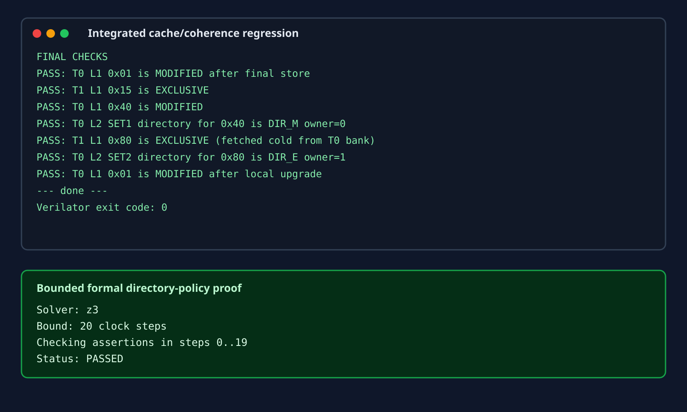
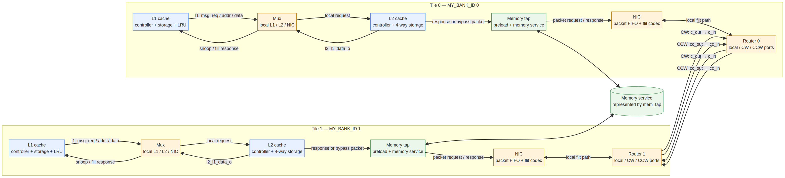
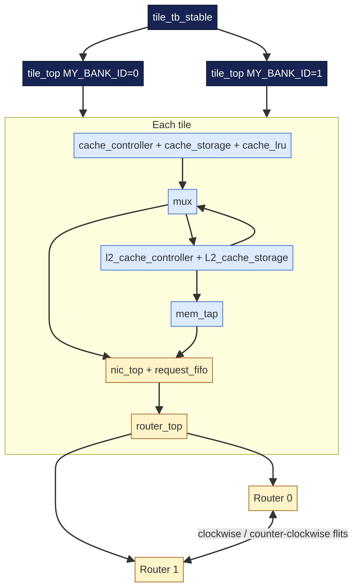
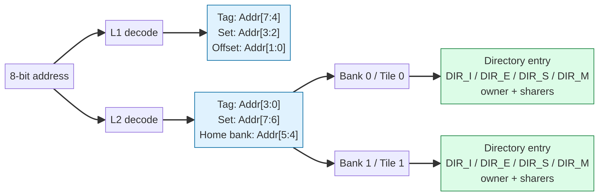
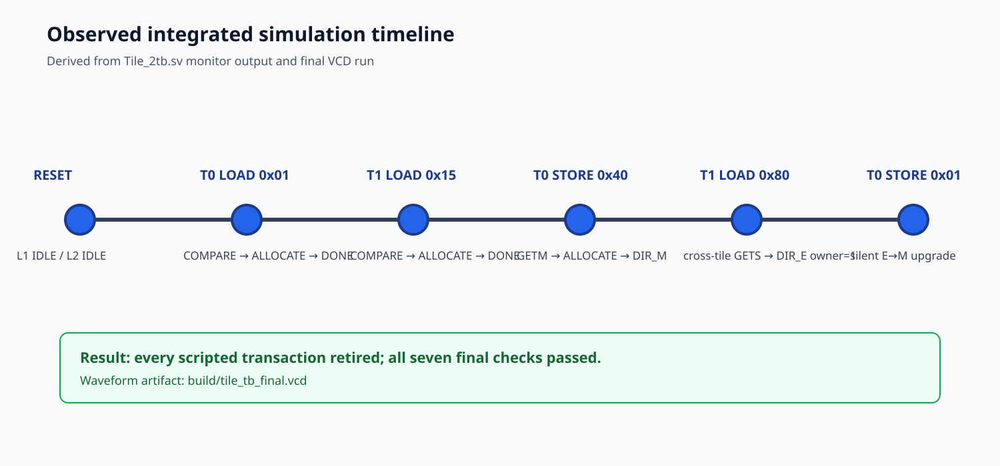

# Design of Cache Coherency in a Tiled Multi-Core Architecture

**Project report and verified implementation record**  
**RTL language:** SystemVerilog  
**Current validated configuration:** two tiles, two private L1 caches, two banked L2 directories, bidirectional ring NoC  
**Repository status:** repaired, linted, simulated, and bounded-formally checked

> This report documents the implementation that exists in this repository after cleanup and repair. It distinguishes implemented behavior, verified behavior, and future work; it does not claim synthesis, FPGA timing, or full RTL formal equivalence where those activities were not run in this environment.

## 1. Executive summary

The design is a small tiled multicore cache-coherence prototype. Each tile contains a private two-way L1 cache, a physically distributed four-way L2 cache bank with directory state, a request multiplexer, a network interface controller, a memory tap, and a three-port router. Tile 0 and Tile 1 are connected as a bidirectional ring. The L2 bank selected by an address acts as the home directory for that block, so a request can be sent directly to its home tile without a global lookup table.

The coherence policy is MESI-inspired. L1 lines use `INVALID`, `EXCLUSIVE`, `SHARED`, and `MODIFIED` stable states plus transient states used while a request, write-back, invalidation, or fill is outstanding. L2 directory entries use `DIR_I`, `DIR_S`, `DIR_E`, and `DIR_M` stable states plus wait states for memory, forwarding, invalidation, and eviction operations. The L2 directory stores a tag, data, owner ID, and sharer mask.

The repaired implementation was verified with a full two-tile Verilator simulation: **7/7 final coherence assertions passed**. The standalone router testbench passed, the standalone L1 testbench completed successfully, and the final integrated Verilator lint reported zero `MULTIDRIVEN` and zero `LATCH` warnings. A Yosys/`yosys-smtbmc`/Z3 proof also passed for 20 bounded steps over an abstraction of the L2 directory transition policy. Direct full-RTL Yosys formalization remains blocked by the project’s SystemVerilog interface/modport syntax; that limitation is documented explicitly in Section 12.



## 2. Requirements and design goals

The design addresses the following educational and architectural goals:

1. Give each core a low-latency private L1 cache.
2. Provide a logically shared but physically banked L2 cache.
3. Keep coherence metadata close to the home L2 data.
4. Carry coherence requests, responses, snoops, and memory traffic over a packetized ring NoC.
5. Use deterministic address decoding so the home tile is computable from the address.
6. Build the design bottom-up from storage, controller, replacement, NIC, router, and tile-level blocks.
7. Verify local hits, cold misses, stores, directory ownership, and a cross-tile fill.
8. Make RTL failures visible through lint diagnostics, simulation assertions, waveform tracing, and a formal policy check.

The current repository is a prototype, not a production cache hierarchy. It has deliberately small data widths and a two-tile target. The design is valuable as a complete architectural demonstration and as a base for extending the number of tiles, improving handshake rigor, and preparing for synthesis.

## 3. Top-level architecture

The top-level simulation module is `tile_tb_stable`. It instantiates two `tile_top` modules. Each tile is parameterized by `MY_BANK_ID`; Tile 0 uses bank ID 0 and Tile 1 uses bank ID 1. The two router clockwise and counter-clockwise ports are cross-connected to form the ring.



The original Mermaid architecture source remains available as [`architecture.mmd`](architecture.mmd). The main path inside each tile is:

```text
Core request
   ↓
Private L1 controller/storage/LRU
   ↓
Mux: local L1 traffic versus L2/NIC traffic
   ↓
Home L2 controller/storage/directory
   ↓
Memory tap or NIC packet path
   ↓
NIC packet FIFO and flit codec
   ↓
Router local/CW/CCW ports
   ↓
Other tile or memory endpoint
```

### 3.1 Tile composition

`tile.sv` is the integration boundary. It creates the L1 interface `cache_v1`, instantiates `cache_controller`, `cache_storage`, and `cache_lru`, then creates the L2 interface `L2_cache` and instantiates `l2_cache_controller` and `L2_cache_storage`. The `mux` selects and translates traffic between the L1 and L2 sides. The `mem_tap` represents the memory service. The `nic_top` converts packets to and from 32-bit router flits, while `router_top` handles local, clockwise, and counter-clockwise paths.

The L2 memory path uses the same packet/NIC link as coherence traffic. The `L2_cache_interface.sv` comments identify this as the implemented “Option B” architecture: there is no separate physical memory request interface in the final interface; memory requests use `NMSG_MEM_REQ` and `NMSG_MEM_DATA` packets.



The structural Mermaid source is [`module_hierarchy.mmd`](module_hierarchy.mmd).

### 3.2 Module inventory

| File | Role | Important implementation detail |
|---|---|---|
| `L1_cache_mem.sv` | L1 package | MESI states, cache-line type, L1 FSM states, L1 message enums |
| `cache_interface.sv` | L1 interface | Shared clock/reset, core request, cache storage, LRU, and coherence fields |
| `cache_controller.sv` | L1 controller | Hit/miss decision, transient states, fills, write-back, snoops |
| `cache_storage.sv` | L1 storage | Four sets × two ways, line writes driven by controller |
| `cache_lru.sv` | L1 replacement | Per-set victim selection and update |
| `l2_cache_pkg.sv` | L2 package | Directory states, packet type, L2 action/decision types |
| `L2_cache_interface.sv` | L2 interface | Local L1 link, NIC link, storage array, response path |
| `L2_cache_controller.sv` | L2 controller | Directory compare, memory fill, forwarding, invalidation, eviction |
| `L2_cache_storage.sv` | L2 storage | Four sets × four ways, directory/data line storage |
| `Mux.sv` | Tile request selection | Connects L1 messages to local L2 or network-facing paths |
| `NIC.sv` | Network interface | Packet FIFO and 32-bit flit pack/unpack |
| `Router.sv` | Ring router | Input FIFOs, route computation, arbitration, crossbar, local/CW/CCW ports |
| `mem.sv` | Memory endpoint | Preload and memory service packet behavior |
| `tile.sv` | Tile integration | Connects caches, mux, memory, NIC, and router |
| `Tile_2tb.sv` | Two-tile testbench | Stimulus, monitor, dumps, final coherence assertions |
| `formal/l2_directory_formal.sv` | Formal abstraction | Solver-checkable L2 directory policy invariants |

## 4. Address mapping and storage organization

The design uses an 8-bit address and 8-bit data word. The address is decoded differently at L1 and L2 because L2 must identify a home bank.



### 4.1 L1 decode

The L1 controller uses:

| Address field | Bits | Meaning |
|---|---:|---|
| Tag | `[7:4]` | Four-bit L1 tag |
| Set | `[3:2]` | Four L1 sets |
| Offset/unused | `[1:0]` | Not used for the line lookup in this word-oriented prototype |

Each L1 line is:

```systemverilog
logic       valid;
MESI_STATES_t C_tag;
logic [3:0] tag;
logic [7:0] data;
```

The L1 storage is `[set 0..3][way 0..1]`, giving four sets and two ways. `cache_lru.sv` supplies the victim way for a set when both ways are occupied.

### 4.2 L2 decode

The L2 controller uses:

| Address field | Bits | Meaning |
|---|---:|---|
| Set | `[7:6]` | Four L2 sets |
| Home bank | `[5:4]` | Tile/bank selected by the address |
| Tag | `[3:0]` | Four-bit L2 tag |

The L2 storage is `[set 0..3][way 0..3]`, giving four sets and four ways per tile. The bank field is used as a deterministic home-tile selection. In the validated testbench, `0x40` maps to the T0 home bank and `0x80` maps to the T0 home bank while the requester is T1; this is why `0x80` demonstrates a genuine remote cold fill.

An L2 line contains:

```systemverilog
logic        valid;
dir_state_t  C_tag;
logic [3:0]  tag;
logic [3:0]  sharers;
logic [1:0]  owner_id;
logic [7:0]  data;
```

The exact packed update width is 23 bits: valid, directory state, tag, sharers, owner, and data.

## 5. Coherence protocol

### 5.1 L1 stable and transient states

The L1 package defines the following states:

| State | Meaning |
|---|---|
| `INVALID` | No usable line is present |
| `EXCLUSIVE` | This tile has the only clean copy |
| `SHARED` | Multiple tiles may hold clean copies |
| `MODIFIED` | This tile has the only dirty copy |
| `IS_D` | Read miss request sent; waiting for data |
| `IM_D` | Write miss request sent; waiting for data |
| `SM_D` | Shared-to-modified upgrade outstanding |
| `EI_A` | Eviction/allocation transient associated with an exclusive line |
| `MI_A` | Eviction/allocation transient associated with a modified line |

The stable states are the familiar MESI meanings. The transient states are necessary because a controller cannot safely overwrite a line, release a request, or retire an instruction while an external response is still outstanding.

### 5.2 L2 directory states

The L2 package defines:

| State | Meaning |
|---|---|
| `DIR_I` | No valid directory entry |
| `DIR_S` | Multiple sharers; `sharers` mask identifies them |
| `DIR_E` | One clean exclusive owner |
| `DIR_M` | One modified owner |
| `DIR_MEM_WAIT` | Waiting for memory data |
| `DIR_FWD_WAIT` | Waiting for forwarded owner data |
| `DIR_INV_WAIT` | Waiting for invalidation acknowledgements |
| `DIR_EVICT_INV_WAIT` | Eviction invalidation phase |
| `DIR_EVICT_FWD_WAIT` | Eviction owner recall phase |
| `DIR_EVICT_WB` | Eviction write-back phase |
| `PROXY_WAIT` | Reserved/proxy wait state |

The stable directory state and metadata define the ordering point for a home block. The wait states encode the fact that the directory has accepted a request but cannot yet complete the state transition.

### 5.3 Message vocabulary

L1-to-directory messages include `MSG_GETS`, `MSG_GETM`, `MSG_PUTE`, `MSG_PUTM`, `MSG_UNBLOCK`, `MSG_INVACK`, `MSG_DATAFWD`, and `MSG_ACK`. Directory-to-L1 inputs include `MSG_FWD_GETS`, `MSG_FWD_GETM`, `MSG_INV`, `MSG_DATA`, and `MSG_NONE`.

The L2/NIC vocabulary extends this with `NMSG_GETS`, `NMSG_GETM`, `NMSG_PUTE`, `NMSG_PUTM`, `NMSG_INVACK`, `NMSG_DATAFWD`, `NMSG_FWD_GETS`, `NMSG_FWD_GETM`, `NMSG_INV`, `NMSG_DATA`, `NMSG_MEM_REQ`, and `NMSG_MEM_DATA`.

### 5.4 Decision policy

The L2 function `l2_dir_hit_decide` implements the key hit policy:

- `DIR_S + GETS` → local hit, remain `DIR_S`.
- `DIR_S + GETM` → invalidate sharers, then transition through `DIR_INV_WAIT`.
- `DIR_E` or `DIR_M` with the owner requesting → local hit, preserve the state.
- `DIR_E` or `DIR_M` with a different requester → forward to the owner and wait in `DIR_FWD_WAIT`.
- No tag match → miss/fill path.

The L2 eviction decision distinguishes an invalid victim, a shared victim requiring invalidations, and an exclusive/modified victim requiring owner recall. This separation is important because a shared line cannot be silently discarded while other L1s may still hold copies.

## 6. Network-on-chip implementation

### 6.1 NIC flit format

`NIC.md` documents the canonical 32-bit flit:

| Bits | Field |
|---|---|
| `[31:30]` | Destination tile ID, low two bits |
| `[29:28]` | Source tile ID, low two bits |
| `[27:24]` | `l2_nic_msg_t` message type |
| `[23]` | Write enable |
| `[22]` | Exclusive response flag |
| `[21:14]` | Address |
| `[13:6]` | Data |
| `[5:0]` | Reserved/zero |

The router routes using the destination field `[31:30]`. Message interpretation remains at the NIC/cache layers; the router is not a message-aware coherence engine.

### 6.2 Router structure

The router has local, clockwise, and counter-clockwise ports. Its internal structure is composed of input FIFOs, flit decoding, route computation, arbitration, and crossbar selection. For a ring of `N` routers, clockwise and counter-clockwise distances can be compared to choose a direction. The current testbench exercises local delivery, clockwise routing, counter-clockwise routing, and multiple-input contention.

The project intentionally uses small input FIFOs rather than a bufferless deflection network. This is a teaching-oriented design choice: it makes backpressure and packet retention easier to observe while retaining the conceptual scalability of a ring.


## 7. RTL control flow

### 7.1 L1 flow

The L1 controller begins in `IDLE`. A core load/store request advances to `COMPARE`. A hit can complete locally or initiate an upgrade. A miss selects an invalid way or an LRU victim and enters `ALLOCATE`; a dirty victim can first require `WRITEBACK`. A response/fill writes the line, returns data where applicable, and eventually raises `done` before returning to `IDLE`.

The essential path is:

```text
IDLE
  ├─ core request → COMPARE
  ├─ snoop request → SNOOP
  └─ fill_pending → ALLOCATE

COMPARE
  ├─ hit → DONE
  ├─ miss → ALLOCATE
  ├─ modified victim → WRITEBACK
  └─ transient upgrade → ALLOCATE

ALLOCATE
  ├─ data/ack accepted → DONE
  └─ waiting → ALLOCATE

DONE → IDLE, or SNOOP/ALLOCATE if a new coherence event is already present
```

### 7.2 L2 flow

The repaired L2 controller separates state ownership and decision timing. `compare_settled` captures that the controller has spent a clock in `L2_COMPARE`, preventing same-edge request capture and cache lookup from being confused. The main state machine is:

```text
L2_IDLE
  ├─ local L1 directory request → L2_COMPARE
  ├─ NIC directory request → L2_COMPARE
  └─ NIC snoop request → L2_SNOOP

L2_COMPARE
  ├─ hit/decision complete → L2_DONE
  ├─ memory miss → L2_ALLOCATE / DIR_MEM_WAIT
  ├─ owner recall → L2_ALLOCATE / DIR_FWD_WAIT
  └─ sharer invalidation → L2_ALLOCATE / DIR_INV_WAIT

L2_ALLOCATE
  ├─ memory/forward/invalidation response → L2_DONE
  └─ waiting → L2_ALLOCATE

L2_SNOOP
  ├─ local response/ack → L2_DONE
  └─ waiting → L2_SNOOP

L2_DONE → L2_IDLE
```

The key repair was not merely changing a warning. The original controller could reach a compare state without a reliable same-cycle progression to the correct fill/response path. The repaired sequencing keeps request metadata, pending directory state, and response flags under one sequential owner and uses explicit combinational completion signals.

## 8. End-to-end transaction examples

### 8.1 T0 cold load of `0x01`

1. The testbench asserts a load instruction on T0.
2. L1 decodes set `0`, tag `0`; the line is absent.
3. L1 selects a free way and sends `MSG_GETS`.
4. T0 L2 receives the request and finds no directory entry.
5. T0 L2 enters `DIR_MEM_WAIT` and sends a memory request.
6. The memory tap returns data.
7. L2 allocates the line and returns data with an exclusive indication.
8. T0 L1 installs the line as `EXCLUSIVE`.
9. The later local store silently upgrades the L1 line to `MODIFIED`, because no other tile has a copy.

The final testbench check correctly expects `MODIFIED` after that later store.

### 8.2 T0 write miss of `0x40`

The T0 store uses `GETM` semantics. The address maps to L2 set 1 and T0’s home bank. The memory fill returns the requested data, and the line is installed as modified for T0. The final directory check observes `DIR_M`, owner ID 0.

### 8.3 T1 cold load of `0x80` from T0’s bank

This is the most important cross-tile regression. T1 issues a `GETS` for an address whose L2 home is T0. T0’s L2 has no matching directory entry, so it fetches from memory, allocates the directory entry with T1 as the requester/owner, and sends the data through the NIC and ring. T1 installs the line as `EXCLUSIVE`; T0’s directory records `DIR_E`, owner 1. This demonstrates that the physically distributed L2 is logically shared.

## 9. Testbench and evidence methodology

`Tile_2tb.sv` performs four principal scripted transactions:

| Test | Stimulus | Expected behavior |
|---|---|---|
| 1 | T0 load `0x01` | Memory fill and exclusive line |
| 2 | T1 load `0x15` | Independent local-bank miss and exclusive line |
| 4 | T0 store `0x40` | GETM fill and modified line/directory |
| 6 | T1 load `0x80` | Cross-tile cold fill, T1 exclusive, T0 DIR_E owner 1 |
| 7 | T0 store `0x01` | Silent local E→M upgrade |

The testbench uses `wait (C_PS == COMPARE)` and a clock edge before releasing a request. This matters because the controller samples the instruction at a clock boundary. A fixed pulse that is too short can disappear before the controller processes it, producing a false pass or a hang.

The testbench records `$monitor` state transitions, ring traffic, cache dumps, and a VCD through `$dumpfile("build/tile_tb.vcd")` and `$dumpvars`. The final repaired run uses Verilator timing, assertions, and trace support.




## 10. Verification results

### 10.1 Integrated test result

The final integrated run passed all seven final checks:

| Assertion | Observed result |
|---|---|
| T0 L1 `0x01` after final store | `MODIFIED` |
| T1 L1 `0x15` | `EXCLUSIVE` |
| T0 L1 `0x40` | `MODIFIED` |
| T0 L2 set 1 / `0x40` | `DIR_M`, owner 0 |
| T1 L1 `0x80` | `EXCLUSIVE` |
| T0 L2 set 2 / `0x80` | `DIR_E`, owner 1 |
| T0 L1 `0x01` local upgrade | `MODIFIED` |

The simulation exits with code 0 and reaches `$finish` at the end of the testbench.

### 10.2 Standalone results

The router testbench completes with `ROUTER TEST COMPLETED` and exit code 0. It covers local delivery, clockwise routing, counter-clockwise routing, and multiple-input routing. The standalone L1 testbench `cache_L1_top` completes its scripted operations and reaches `$finish` with exit code 0.

### 10.3 Lint results

The final integrated command was:

```bash
verilator --lint-only --timing --language 1800-2012 --Wall --Wno-fatal \
  --top-module tile_tb_stable \
  L1_cache_mem.sv l2_cache_pkg.sv cache_interface.sv cache_controller.sv \
  cache_storage.sv cache_lru.sv L2_cache_interface.sv L2_cache_controller.sv \
  L2_cache_storage.sv NIC.sv Router.sv Mux_interface.sv Mux.sv mem.sv tile.sv Tile_2tb.sv
```

The requested structural diagnostics are zero:

```text
MULTIDRIVEN warnings: 0
LATCH warnings:       0
lint exit code:       0
```

Nonfatal style warnings remain. They include incomplete case coverage, blocking assignments in some sequential/testbench contexts, nonblocking assignments in an older combinational L1 decision block, and a mixed synchronous/asynchronous reset warning in the testbench. These are documented as remaining technical debt in `Changes.md`; they are distinct from the repaired multiple-driver and inferred-latch defects.

### 10.4 Formal result

The formal abstraction uses unconstrained request sequences and requester IDs. It asserts directory invariants after every clocked transition. The command is:

```bash
yosys -ql build/formal/yosys.log build/formal/l2_directory.ys
yosys-smtbmc -s z3 -t 20 \
  --dump-vcd build/formal/l2_directory_counterexample.vcd \
  build/formal/l2_directory.smt2
```

The proof log reports:

```text
Checking assertions in step 0..19
Status: PASSED
```

This is a bounded policy proof, not a proof of every RTL signal in the interface-based implementation. Yosys stops at the SystemVerilog interface syntax when asked to read the complete cache RTL directly. The repository retains both the exact formal model and the failed direct-elaboration log so the verification boundary is auditable.

## 11. Reproducing the results

From the repository root:

```bash
# Integrated lint
verilator --lint-only --timing --language 1800-2012 --Wall --Wno-fatal \
  --top-module tile_tb_stable \
  L1_cache_mem.sv l2_cache_pkg.sv cache_interface.sv cache_controller.sv \
  cache_storage.sv cache_lru.sv L2_cache_interface.sv L2_cache_controller.sv \
  L2_cache_storage.sv NIC.sv Router.sv Mux_interface.sv Mux.sv mem.sv tile.sv Tile_2tb.sv

# Integrated simulation with VCD
verilator --binary --timing --trace --assert --Wno-fatal \
  --language 1800-2012 --top-module tile_tb_stable \
  L1_cache_mem.sv l2_cache_pkg.sv cache_interface.sv cache_controller.sv \
  cache_storage.sv cache_lru.sv L2_cache_interface.sv L2_cache_controller.sv \
  L2_cache_storage.sv NIC.sv Router.sv Mux_interface.sv Mux.sv mem.sv tile.sv Tile_2tb.sv \
  -Mdir build/final_obj -o tile_tb_final
build/final_obj/tile_tb_final

# Router-only test
verilator --binary --timing --top-module tb_router Router.sv \
  -Mdir build/router_obj -o router_tb
build/router_obj/router_tb

# Formal policy check
yosys -ql build/formal/yosys.log build/formal/l2_directory.ys
yosys-smtbmc -s z3 -t 20 build/formal/l2_directory.smt2
```

### Tool assumptions

The validated environment used Verilator, Yosys 0.33, Z3, and the repository’s installed diagram renderer. Icarus is not the primary validation simulator because the interface-heavy SystemVerilog is more reliably handled by Verilator in this project.

## 12. Limitations and future work

1. **Full RTL formalization:** convert or flatten interfaces for a direct Yosys/SMT proof of the actual controllers.
2. **Synthesis and STA:** run a target FPGA synthesis, utilization report, timing analysis, and CDC review. No such result is claimed by this report.
3. **Handshake rigor:** replace several simplified always-ready connections with explicit ready/valid contracts end-to-end.
4. **Reset/style cleanup:** convert remaining nonblocking assignments in combinational blocks, complete case defaults, and normalize sequential assignments.
5. **Scalability:** generalize tile count, router IDs, sharer-mask width, bank count, and address width.
6. **Data width and line size:** add byte/word offsets and multi-word cache lines rather than the current single 8-bit data word.
7. **Protocol completeness:** expand directed tests for shared reads, invalidation acknowledgements, modified owner forwarding, dirty eviction, and simultaneous requests.
8. **Performance:** measure latency, FIFO occupancy, arbitration fairness, and ring utilization.
9. **Memory model:** replace the simplified `mem_tap` with a proper memory controller and response backpressure.

## 13. Artifact index

- [`architecture.mmd`](architecture.mmd) — main architecture Mermaid source.
- [`architecture.png`](architecture.png) — existing architecture render.
- [`module_hierarchy.mmd`](module_hierarchy.mmd) and [`module_hierarchy.png`](module_hierarchy.png) — structural hierarchy.
- [`transaction_sequence.mmd`](transaction_sequence.mmd) and [`transaction_sequence.png`](transaction_sequence.png) — remote-load sequence.
- [`address_mapping.mmd`](address_mapping.mmd) and [`address_mapping.png`](address_mapping.png) — address decode.
- [`verification_evidence.svg`](verification_evidence.svg) — terminal-style simulation/formal evidence panel.
- [`waveform_timeline.svg`](waveform_timeline.svg) — observed transaction timeline.
- [`build/tile_tb_final.log`](build/tile_tb_final.log) — integrated simulation log.
- [`build/tile_tb_final.vcd`](build/tile_tb_final.vcd) — integrated waveform.
- [`build/final_lint.log`](build/final_lint.log) — lint evidence.
- [`build/formal/smtbmc.log`](build/formal/smtbmc.log) — formal proof evidence.
- [`verification_report.md`](verification_report.md) — concise verification report.
- [`Changes.md`](Changes.md) — repair history and flaw analysis.
- [`Cheat_sheet.md`](Cheat_sheet.md) — beginner-to-advanced operational guide.
